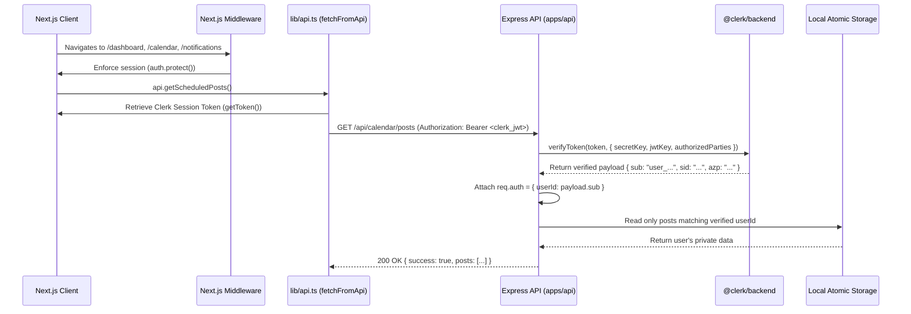

# Authentication & Access Control Architecture (Step 2.2)

## 1. Overview

EntangledEcho secures both the Next.js frontend (`apps/web`) and the Express REST API (`apps/api`) using **Clerk Authentication** with server-side cryptographic JWT verification, alongside hardened HMAC-based administrative session controls.

Under this architecture:
- The Express API **never trusts** client-supplied user identifiers from URL query parameters (`req.query.userId`), request bodies (`req.body.userId`), or custom headers.
- Every user-protected endpoint requires an `Authorization: Bearer <token>` header containing a valid Clerk session JWT.
- Bearer tokens are cryptographically verified on the server using `@clerk/backend` (`verifyToken`).
- The verified subject claim (`payload.sub`) is attached to `req.auth.userId`.
- Any client-supplied `userId` in query or body parameters is automatically overwritten by the verified identity before reaching route handlers.
- **Authorized Parties (`azp`) Enforcement**: Clerk tokens must match an approved origin listed in `CLERK_AUTHORIZED_PARTIES` (e.g. `http://localhost:3000,http://127.0.0.1:3000`). Tokens with unauthorized `azp` values are rejected with `401 Unauthorized`.
- **Key Resolution Strategy**:
  1. If `CLERK_JWT_KEY` is set: uses local static PEM RSA public key verification (optimal for local development, CI, and hermetic offline testing).
  2. If `CLERK_SECRET_KEY` is set and `CLERK_JWT_KEY` is unset: uses Clerk remote JWKS network verification.
  3. If neither is set: fails closed with `500 Internal Server Error` (or `401 Unauthorized` on authentication attempts).
- **Admin Authentication Hardening (FR-06)**:
  - The insecure fallback default `admin123` is completely eliminated.
  - The unhashed bypass cookie `admin_auth=true` is completely rejected.
  - Admin access requires either constant-time header authentication (`ADMIN_SECRET_KEY` / `ADMIN_PASSWORD`), an HMAC-SHA256 signed session cookie (`admin_session`), or a verified Clerk JWT with `role === 'admin'`.
  - Admin session cookies are set with `HttpOnly: true`, `SameSite: Lax`, and `Secure` in production.
- **Social Account Ownership Enforcement**:
  - User-to-account relationships are stored in `storage/user_sessions/${userId}.json`.
  - Scheduled posts (`POST /api/calendar/posts`), recommendation feedback (`POST /api/recommendations/feedback`), and recommendation generation (`POST /api/recommendations/generate`) strictly require the caller to own the targeted account handle or hold administrator privileges.
  - Linking an account (`POST /api/graph/connect`) prevents account hijacking: if another user has already linked the handle, access is rejected with `403 Forbidden`.
- **Private Audience Demographics Protection (FR-30)**:
  - `GET /api/accounts/:handle/audience` is protected by `requireUserOrAdmin`.
  - Only the verified account owner or an administrator can view audience demographics. Unauthorized queries return `403 Forbidden` without leaking whether audience data exists.
- **Internal Scraper Route Protection**:
  - `/api/session/status`, `/api/session/canary`, and `/api/session/curated-list` require verified administrator privileges (`requireAdmin`), preventing unauthenticated Chromium process launches and scraping Denial of Service.

---

## 2. Token Flow & Verification Lifecycle



---

## 3. Route Access Control Matrix

| Category | Endpoint | Method | Required Auth | Tenant Boundary / Enforcement |
| :--- | :--- | :--- | :--- | :--- |
| **Public** | `/health` | `GET` | None | Public service health check |
| **Public** | `/api/accounts` | `GET` | None | Public discovery of creators |
| **Public** | `/api/accounts/:handle` | `GET` | None | Public creator profile inspection |
| **Public** | `/api/accounts/:handle/posts` | `GET` | None | Public scraped historical posts |
| **Public** | `/api/accounts/:handle/export/csv` | `GET` | None | Public CSV export |
| **Public** | `/api/accounts/competitors/compare` | `GET` | None | Public competitive comparison |
| **Public** | `/api/recommendations/live-trends` | `GET` | None | Public Google Trends RSS feed |
| **Public** | `/api/models` | `GET` | None | Model registry overview |
| **Public** | `/api/models/eval/latest` | `GET` | None | Model evaluation report |
| **Public** | `/api/models/eval/runs` | `GET` | None | Evaluation history |
| **Public** | `/api/calendar/slots/recommended` | `GET` | Optional | Creator historical peak slots |
| **Public** | `/api/media/*` | `GET` | None | Static media serving |
| **Public** | `/api/notifications/digest/preview` | `GET` | Optional | Email HTML template preview |
| **User (Owner) / Admin** | `/api/accounts/:handle/audience` | `GET` | Clerk JWT or Admin (`requireUserOrAdmin`) | Restricted to verified account owner or admin. Unauthorized callers receive 403 Forbidden without existence leakage. |
| **User Protected** | `/api/calendar/posts` | `GET` | Clerk JWT (`requireAuth`) | Returns only posts where `userId === req.auth.userId` |
| **User Protected** | `/api/calendar/posts/:id` | `GET` | Clerk JWT (`requireAuth`) | Returns post only if `userId === req.auth.userId`; otherwise 404 |
| **User Protected** | `/api/calendar/posts` | `POST` | Clerk JWT (`requireAuth`) | Verifies `accountHandle` is owned by caller (`isUserAccountOwnerOrAdmin`). Forces post `userId = req.auth.userId`. |
| **User Protected** | `/api/calendar/posts/:id` | `PATCH` | Clerk JWT (`requireAuth`) | Updates post only if `userId === req.auth.userId` |
| **User Protected** | `/api/calendar/posts/:id/reschedule` | `PATCH` | Clerk JWT (`requireAuth`) | Reschedules post only if `userId === req.auth.userId` |
| **User Protected** | `/api/calendar/posts/:id/publish` | `POST` | Clerk JWT (`requireAuth`) | Publishes post only if `userId === req.auth.userId` |
| **User Protected** | `/api/calendar/posts/:id` | `DELETE` | Clerk JWT (`requireAuth`) | Deletes post only if `userId === req.auth.userId` |
| **User Protected** | `/api/notifications` | `GET` | Clerk JWT (`requireAuth`) | Returns notifications for verified `req.auth.userId` |
| **User Protected** | `/api/notifications/:id/read` | `PATCH` | Clerk JWT (`requireAuth`) | Marks as read for verified `req.auth.userId` |
| **User Protected** | `/api/notifications/mark-all-read` | `POST` | Clerk JWT (`requireAuth`) | Marks all as read for verified `req.auth.userId` |
| **User Protected** | `/api/notifications/preferences` | `GET` | Clerk JWT (`requireAuth`) | Returns preferences for verified `req.auth.userId` |
| **User Protected** | `/api/notifications/preferences` | `PUT` | Clerk JWT (`requireAuth`) | Updates preferences for verified `req.auth.userId` |
| **User Protected** | `/api/notifications/create` | `POST` | Clerk JWT (`requireAuth`) | Emits in-app alert for verified `req.auth.userId` |
| **User Protected** | `/api/notifications/digest/trigger` | `POST` | Clerk JWT (`requireAuth`) | Sends digest for verified `req.auth.userId` |
| **User Protected** | `/api/onboarding/user-profile` | `POST` | Clerk JWT (`requireAuth`) | Stores profile under verified `req.auth.userId` |
| **User Protected** | `/api/onboarding/user-profile/:userId` | `GET` | Clerk JWT (`requireAuth`) | Rejects cross-tenant access with 403 Forbidden |
| **User Protected** | `/api/onboarding/user-profile` | `GET` | Clerk JWT (`requireAuth`) | Returns caller's profile (`req.auth.userId`) |
| **User Protected** | `/api/recommendations/feedback` | `POST` | Clerk JWT (`requireAuth`) | Enforces account ownership (`isUserAccountOwnerOrAdmin`). |
| **User Protected** | `/api/recommendations/preferences` | `GET` | Clerk JWT (`requireAuth`) | Returns user recommendation preference weights |
| **User Protected** | `/api/recommendations/generate` | `POST` | Clerk JWT (`requireAuth`) | Enforces account ownership (`isUserAccountOwnerOrAdmin`). |
| **User Protected** | `/api/graph/connect` | `POST` | Clerk JWT (`requireAuth`) | Prevents account hijacking: blocks linking an account already claimed by another user. |
| **User Protected** | `/api/graph/validate-token` | `POST` | Clerk JWT (`requireAuth`) | Validates Meta access token |
| **User / Admin** | `/api/scrape` | `POST` | Clerk JWT or Admin | Submits account scrape job |
| **User / Admin** | `/api/jobs` | `GET` | Clerk JWT or Admin | Lists job queue status |
| **User / Admin** | `/api/jobs/:id/retry` | `POST` | Clerk JWT or Admin | Retries scrape job |
| **User / Admin** | `/api/jobs/:id/cancel` | `POST` | Clerk JWT or Admin | Cancels scrape job |
| **User / Admin** | `/api/models/predict` | `POST` | Clerk JWT or Admin | Runs engagement rate inference |
| **User / Admin** | `/api/models/train-personal/:handle` | `POST` | Clerk JWT or Admin | Trains personalized ridge model |
| **Admin Only** | `/api/admin/*` | `*` | Admin Credentials (`FR-06`) | System status and raw queue metrics. No unverified cookies or bypasses. |
| **Admin Only** | `/api/session/*` | `GET` | Admin Credentials (`requireAdmin`) | Chromium session inspection and canary scraper. |
| **Admin Only** | `/api/jobs/pause` | `POST` | Admin Credentials | Pauses worker queue |
| **Admin Only** | `/api/jobs/resume` | `POST` | Admin Credentials | Resumes worker queue |
| **Admin Only** | `/api/jobs/:id` | `DELETE` | Admin Credentials | Deletes job from queue |
| **Admin Only** | `/api/jobs` | `DELETE` | Admin Credentials | Clears completed/queued jobs |
| **Admin Only** | `/api/models/train-global` | `POST` | Admin Credentials | Trains global XGBoost model |
| **Admin Only** | `/api/models/eval/run` | `POST` | Admin Credentials | Executes model evaluation harness |
| **Admin Only** | `/api/models/:id` | `DELETE` | Admin Credentials | Deletes model from registry |
| **Admin Only** | `/api/accounts/:idOrHandle` | `DELETE` | Admin Credentials (`requireAuth`) | Deletes account and associated files |
| **Internal Only** | `/internal/tick` | `POST`/`GET` | `INTERNAL_TICK_SECRET` | Scheduled 60s automated publisher daemon |

---

## 4. Verification & Automated Testing

The automated test suite `scripts/test_clerk_auth.ts` verifies 61 discrete security checks across 11 suites:
1. **Dependency Resolution & Packaging**: `@clerk/backend` is declared as a direct dependency in `apps/api/package.json` and resolved through pnpm's content-addressable store (`.pnpm`) without ad-hoc symlinks.
2. **Unauthenticated / Malformed Handling**: Every protected route rejects missing, empty, or malformed credentials with `401 Unauthorized`.
3. **Cryptographic JWT Validation**: Validates RS256 token signatures against RSA public keys, verifies expiration, and enforces allowed `azp` origins.
4. **Admin Privileges & Bypass Elimination**: Rejects insecure default `admin123` and unsigned `admin_auth=true` cookie. Validates HMAC-SHA256 signed admin session cookies, constant-time header secrets, and Clerk admin role claims.
5. **Scraper Route Protection**: Proves `/api/session/status`, `/api/session/canary`, and `/api/session/curated-list` return `403 Forbidden` for unauthenticated callers and regular users, preventing DoS via unauthorized browser launching.
6. **Audience Demographics Privacy (FR-30)**: Proves unauthenticated callers get 401, non-owners get 403 (with zero information leakage on whether data exists), and only verified owners and admins get 200.
7. **Social Account Ownership**: Verifies that users cannot schedule posts, submit feedback, or generate recommendations for other users' accounts, and cannot hijack accounts already claimed by another user.
8. **Public Endpoints**: Verifies public health and creator discovery endpoints remain accessible without tokens.
9. **Handle Ownership & Uniqueness (FIX 2)**: Enforces unique handles during onboarding (409 Conflict), denies self-asserted unverified handle access (403 Forbidden), and non-destructively migrates legacy duplicate records.
10. **Authorization on Mutations (FIX 3)**: Requires admin for account deletion (403 Forbidden), requires internal tick secret with exact 401/503 fail-closed behavior, blocks scheduled post account reassignment (403 Forbidden), protects recommendation preferences (403 Forbidden), and restricts personal model training (403 Forbidden).
11. **Admin Session Cookie & Proxy Forwarding (FIX 1)**: Verifies that admin sessions authenticate upstream via HttpOnly signed session cookies, that client authorization headers are stripped, and that unauthenticated proxy attempts to admin routes are rejected with 403 Forbidden.

Run the test suite with:
```bash
./apps/api/node_modules/.bin/tsx scripts/test_clerk_auth.ts
```

---

## 5. Secret Rotation Inventory

Per the security audit guidelines, committed credentials must be cataloged and marked for immediate rotation. Git history is intentionally preserved without destructive force-pushes or history rewrites to preserve audit traceability and build reproducibility.

| Commit | File | Secret Type | Fingerprint | Status |
| :--- | :--- | :--- | :--- | :--- |
| `048ee8d` | `.env.local` / config | Supabase Service Role Key | `eyJhbG...[redacted]` | Compromised - Rotation pending operator confirmation |
| `00135d6` | `docker-compose.yml` / env | Admin Password | `adm...[redacted]` | Compromised - Rotation pending operator confirmation |
| Legacy (Working Tree) | `scripts/test_browser_live_account.ts` | Meta Graph API Access Token | `EAAB...[redacted]` | Compromised - Rotation pending operator confirmation |
| `cd97ebc` | `scripts/test_admin_browser_login.mjs` | Test Admin Credentials | `TEST_A...WORD` | Test Fixture - Rotation pending operator confirmation |
| `4dde450` | `docker-compose.yml` | Default Admin Password | `admin...123` | Compromised - Rotation pending operator confirmation |
| `4dde450` | `.env.example` | Default Admin Password | `admin...123` | Example Config - Rotation pending operator confirmation |
| `6f5c3f0` | `.env.example` | Default Admin Password | `admin...123` | Example Config - Rotation pending operator confirmation |

### Rotation Action Plan:
1. **Supabase Service Role Key**: Generate a new service role secret in the Supabase project dashboard; revoke the legacy token.
2. **Admin Password / Admin Secret Key**: Deploy with cryptographically generated 256-bit entropy keys via `openssl rand -base64 32`. In production, if unset, the application fails closed with 503 instead of falling back to default values.
3. **Meta Graph API Tokens**: Revoke existing user and system user tokens in the Meta Developer Portal; issue fresh tokens with restricted development scopes.
4. **Internal Tick Secret**: Configure a secure random token in environment variables; unconfigured deployments fail closed with 503.
